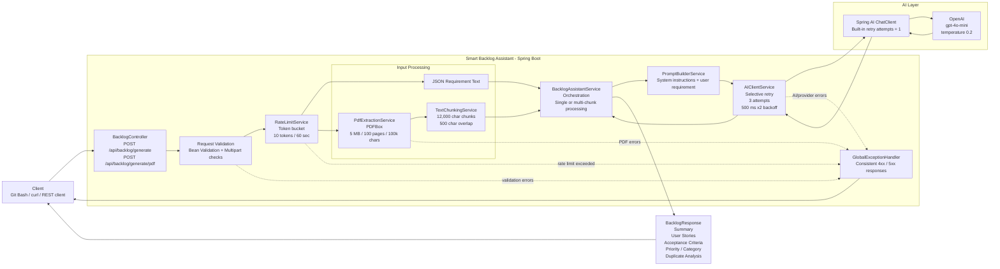

# Smart Backlog Assistant

AI-enhanced engineering solution that converts requirement text or PDF documents into a structured software backlog.

The application accepts plain requirements or PDF input, validates and protects the request path, builds a controlled AI prompt, calls an OpenAI model through Spring AI, and returns structured backlog output including a summary, user stories, acceptance criteria, priority, category, and duplicate-analysis information.

## Key Features

-   REST endpoint for requirement text
-   REST endpoint for PDF requirements
-   Structured AI output using Spring AI
-   PDF validation and text extraction with Apache PDFBox
-   Large-document chunking with overlap
-   Selective retry with exponential backoff
-   In-memory token-bucket rate limiting
-   Centralized exception handling
-   Bean-validation based request validation
-   Automated unit, controller, service, and Spring context tests
-   API key supplied through an environment variable; no API key is stored in source control

## Technology Stack

Area

Technology

Language

Java 17

Framework

Spring Boot 3.5.4

AI integration

Spring AI 1.0.1

AI provider

OpenAI

Model

`gpt-4o-mini`

PDF processing

Apache PDFBox 3.0.5

Build

Maven

Testing

JUnit 5, Mockito, Spring Test / MockMvc

Validation

Jakarta Bean Validation

Runtime

Embedded Tomcat, port 8080

Spring Boot Actuator

Health and metrics endpoints

Micrometer

Spring AI / application observability

## Technical Architecture



### Request Flow

For JSON input:

`Client -> Controller -> Validation -> Rate Limit -> BacklogAssistantService -> PromptBuilderService -> AIClientService -> Spring AI -> OpenAI -> Structured BacklogResponse`

For PDF input:

`Client -> Controller -> Validation -> Rate Limit -> PdfExtractionService -> TextChunkingService -> BacklogAssistantService -> PromptBuilderService -> AIClientService -> Spring AI -> OpenAI -> Structured BacklogResponse`

If the extracted PDF text is larger than the configured chunk size, it is split into overlapping chunks. Each chunk is processed independently and the generated backlog content is combined by the service layer.

## Important Configuration

The final application configuration should contain the following values:

```yaml
spring:
  application:
    name: backlog-assistant

  servlet:
    multipart:
      max-file-size: 5MB
      max-request-size: 5MB

  ai:
    retry:
      max-attempts: 1
      on-client-errors: false

    openai:
      api-key: ${OPENAI_API_KEY}
      chat:
        options:
          model: gpt-4o-mini
          temperature: 0.2

server:
  port: 8080

app:
  ai:
    retry:
      max-attempts: 3
      initial-delay-ms: 500
      multiplier: 2.0

  rate-limit:
    capacity: 10
    refill-tokens: 10
    refill-period-seconds: 60

  pdf:
    max-file-size-bytes: 5242880
    max-pages: 100
    max-extracted-characters: 100000
    chunk-size: 12000
    chunk-overlap: 500

logging:
  level:
    com.fde.backlogassistant: INFO
```

### Why there are two retry configurations

`spring.ai.retry.max-attempts: 1` prevents nested provider-level retries from multiplying the number of requests.

`app.ai.retry` is the application-owned retry policy implemented in `AIClientService`.

The custom policy retries transient failures such as:

-   HTTP 429
-   timeouts / connection failures
-   HTTP 502, 503, and 504
-   temporarily unavailable provider errors

Permanent failures such as HTTP 401, HTTP 403, invalid API keys, and invalid model errors fail immediately.

## Prerequisites

Install:

-   Java 17
-   Maven 3.x
-   Git Bash on Windows
-   An OpenAI API key with available API credit

Verify:

```bash
java -version
mvn -version
```

## API Key Setup

Never place the real API key in `application.yml`, source code, README, screenshots, or Git history.

For Git Bash, export it for the current terminal session:

```bash
export OPENAI_API_KEY="your-real-api-key"
```

Verify only that the variable exists:

```bash
if [ -n "$OPENAI_API_KEY" ]; then
  echo "OPENAI_API_KEY is set"
else
  echo "OPENAI_API_KEY is NOT set"
fi
```

Do not print the actual key.

If the application is launched from IntelliJ using a Run Configuration, the environment variable configured there is available to that IntelliJ process only. Git Bash does not automatically inherit an IntelliJ Run Configuration variable.

## Build and Run

From the project root:

```bash
mvn clean test
```

Then run the application:

```bash
mvn spring-boot:run
```

Alternatively, run `BacklogAssistantApplication` from IntelliJ.

Successful startup should include:

```text
Tomcat started on port 8080
Started BacklogAssistantApplication
```

## Manual Testing from Git Bash

Run the application first and use another Git Bash terminal for the curl commands.

### 1. Valid JSON Requirement

```bash
curl -i -X POST "http://localhost:8080/api/backlog/generate" 
  -H "Content-Type: application/json" 
  -d '{"requirementText":"Customers who forget their password should be able to reset it using their registered email address."}'
```

Expected:

```text
HTTP/1.1 200
```

The JSON response should contain structured backlog information such as a summary, generated user stories, acceptance criteria, priority, category, and duplicate analysis.

### 2. Empty Requirement - Negative Test

```bash
curl -i -X POST "http://localhost:8080/api/backlog/generate" 
  -H "Content-Type: application/json" 
  -d '{"requirementText":""}'
```

Expected:

```text
HTTP/1.1 400
```

Expected validation response includes a message similar to:

```json
{
  "status": 400,
  "error": "Validation Failed",
  "message": "The request contains invalid data.",
  "validationErrors": {
    "requirementText": "Requirement text is required."
  }
}
```

The AI provider should not be called for this invalid request.

### 3. Valid PDF

Place a PDF such as `meeting-notes.pdf` in the project root:

```bash
curl -i -X POST "http://localhost:8080/api/backlog/generate/pdf" 
  -F "file=@meeting-notes.pdf"
```

Expected:

```text
HTTP/1.1 200
```

### 4. Invalid File Type - Negative Test

Create a text file:

```bash
echo "not a pdf" > invalid.txt
```

Send it to the PDF endpoint:

```bash
curl -i -X POST "http://localhost:8080/api/backlog/generate/pdf" 
  -F "file=@invalid.txt"
```

Expected:

```text
HTTP/1.1 400
```

Expected error message:

```text
Only PDF files are supported.
```

### 5. Force Large-PDF Chunking

The final production-style values are:

```yaml
chunk-size: 12000
chunk-overlap: 500
```

For manual verification only, temporarily change them to:

```yaml
chunk-size: 100
chunk-overlap: 20
```

Restart the application and send the PDF again:

```bash
curl -i -X POST "http://localhost:8080/api/backlog/generate/pdf" 
  -F "file=@meeting-notes.pdf"
```

Expected application logs:

```text
Large document split into X chunks for bounded AI processing.
Processing document chunk 1/X.
Processing document chunk 2/X.
...
```

The manually verified test produced five chunks.

After testing, restore:

```yaml
chunk-size: 12000
chunk-overlap: 500
```

and restart the application.

### 6. Rate-Limit Test

The final values are:

```yaml
capacity: 10
refill-tokens: 10
refill-period-seconds: 60
```

For manual verification only, temporarily use:

```yaml
capacity: 1
refill-tokens: 1
refill-period-seconds: 60
```

Restart the application.

Run the same valid JSON request twice immediately:

```bash
curl -i -X POST "http://localhost:8080/api/backlog/generate" 
  -H "Content-Type: application/json" 
  -d '{"requirementText":"Customers should be able to reset their password using email."}'
```

First request:

```text
HTTP/1.1 200
```

Second immediate request:

```text
HTTP/1.1 429
```

The second request should be rejected before an OpenAI request is made.

After testing, restore:

```yaml
capacity: 10
refill-tokens: 10
refill-period-seconds: 60
```

and restart the application.

### 7. Permanent AI Failure / 401 Test

This verifies that authentication failures are not retried.

Temporarily start the application with an intentionally invalid API key. For Git Bash:

```bash
export OPENAI_API_KEY="invalid-test-key"
mvn spring-boot:run
```

In another terminal:

```bash
curl -i -X POST "http://localhost:8080/api/backlog/generate" 
  -H "Content-Type: application/json" 
  -d '{"requirementText":"Customers should be able to reset their password."}'
```

Expected application log:

```text
Sending backlog-generation request to AI model. Attempt 1/3.
AI model request failed. Retryable: false, attempts: 1, exception: NonTransientAiException
```

There should be no custom application `Attempt 2/3` or `Attempt 3/3`.

Restore the real API key immediately after the test and restart the application.

### 8. Transient Retry Test

Do not deliberately force a real OpenAI 429 for this test. The automated service test is safer, deterministic, and does not consume provider requests.

Run:

```bash
mvn -Dtest=AIClientServiceTest test
```

The test verifies retry behavior such as:

```text
Attempt 1/3
Transient AI failure...
Attempt 2/3
Transient AI failure...
Attempt 3/3
```

It also verifies that a permanent failure stops after one application attempt.

## Automated Test Suite

Run all tests:

```bash
mvn clean test
```

Current verified result:

```text
Tests run: 19, Failures: 0, Errors: 0, Skipped: 0
BUILD SUCCESS
```

Run individual test classes when diagnosing a specific area:

```bash
mvn -Dtest=BacklogControllerTest test
mvn -Dtest=AIClientServiceTest test
mvn -Dtest=BacklogAssistantServiceTest test
mvn -Dtest=PdfExtractionServiceTest test
mvn -Dtest=PromptBuilderServiceTest test
mvn -Dtest=RateLimitServiceTest test
mvn -Dtest=TextChunkingServiceTest test
mvn -Dtest=BacklogAssistantApplicationTest test
```

### Test Coverage by Responsibility

Test

Main responsibility

`BacklogControllerTest`

API/controller behavior and request handling

`AIClientServiceTest`

transient retry, retry exhaustion, fail-fast permanent errors, recovery

`BacklogAssistantServiceTest`

orchestration and multi-chunk processing

`PdfExtractionServiceTest`

PDF validation/extraction and negative cases

`PromptBuilderServiceTest`

prompt construction

`RateLimitServiceTest`

token-bucket rate limiting

`TextChunkingServiceTest`

document chunking and overlap behavior

`BacklogAssistantApplicationTest`

Spring context / dependency-injection smoke test

## Build the Deployable JAR

```bash
mvn clean package
```

Maven runs the test phase before packaging. A successful build should end with:

```text
BUILD SUCCESS
```

The generated JAR is placed under:

```text
target/
```

## Manual Verification Matrix

Scenario

Expected result

Valid JSON requirement

`200` and structured backlog response

Empty requirement

`400` validation error

Valid PDF

`200` and structured backlog response

Non-PDF upload

`400` PDF processing error

Large text over chunk threshold

Multiple chunks processed

Rate-limit capacity exhausted

`429`

Invalid API key / HTTP 401

Fail after application attempt 1

Transient 429 / 5xx / timeout

Retry up to configured maximum

Maven automated suite

19 tests pass

## Error-Handling Strategy

`GlobalExceptionHandler` converts application exceptions into consistent HTTP responses.

Key categories include:

-   Request/validation errors -> 4xx
-   Unsupported or invalid PDF input -> 400
-   Rate-limit exhaustion -> 429
-   AI/provider failure -> controlled service error rather than an unhandled stack trace sent to the client

Detailed internal failures are logged for diagnosis while the REST response remains controlled.

## Key Engineering Decisions

### Low Model Temperature

The model temperature is `0.2` because backlog generation is an engineering workflow where consistency and structured output are more important than creativity.

### Separate System and User Prompts

The stable AI role, output rules, and behavior are maintained separately from request-specific requirement text. This improves maintainability and reduces the chance that requirement content changes application-level AI behavior.

### Application-Owned Retry Policy

Spring AI built-in retry attempts are limited to one. `AIClientService` owns the retry decision so the application can explicitly distinguish transient failures from permanent failures and apply controlled exponential backoff.

### Bounded PDF Processing

The application does not send arbitrarily large documents to the AI provider. It applies limits to upload size, page count, extracted characters, and chunk size.

### Rate Limiting

The token bucket prevents an uncontrolled number of expensive AI calls and returns HTTP 429 when the configured capacity is exhausted.

## Known Limitations

-   The current rate limiter is in memory and applies per application instance. A distributed deployment should use a shared store such as Redis with a distributed limiter.
-   Image-only/scanned PDFs require OCR; PDFBox text extraction alone is not an OCR solution.
-   Chunked AI output can require additional semantic consolidation for very large documents.
-   The project does not currently use a vector database or Retrieval-Augmented Generation.
-   Duplicate analysis is limited to the backlog context supplied to the application; it is not a semantic search across an enterprise backlog repository.
-   LLM output is probabilistic even with a low temperature and must still be reviewed.

Spring AI integrates with Micrometer to publish model-call metrics. Spring Boot Actuator exposes AI token usage, model metadata, operation duration, application health, HTTP metrics, JVM metrics, and other runtime measurements.

## AI Observability

The application uses Spring AI's built-in Micrometer observability together with Spring Boot Actuator.

Spring AI automatically instruments model calls and exposes metrics including:

- AI input token usage
- AI output token usage
- total token usage
- requested and response model information
- AI provider
- model-call operation duration
- HTTP request metrics
- JVM/application runtime metrics

Check application health:

```bash
curl "http://localhost:8080/actuator/health"
```

List available metrics:

```bash
curl "http://localhost:8080/actuator/metrics"
```

Check AI input tokens:

```bash
curl "http://localhost:8080/actuator/metrics/gen_ai.client.token.usage?tag=gen_ai.token.type:input"
```

Check AI output tokens:

```bash
curl "http://localhost:8080/actuator/metrics/gen_ai.client.token.usage?tag=gen_ai.token.type:output"
```

Check total AI tokens:

```bash
curl "http://localhost:8080/actuator/metrics/gen_ai.client.token.usage?tag=gen_ai.token.type:total"
```

Check AI model-call metrics:

```bash
curl "http://localhost:8080/actuator/metrics/gen_ai.client.operation"
```

The token metrics are cumulative for the lifetime of the running application instance. To measure a single request, restart the application before the test or compare the metric value before and after the request.

Example runtime verification for one backlog-generation request:

```text
Input tokens  = 828
Output tokens = 292
Total tokens  = 1120
Provider      = openai
Requested     = gpt-4o-mini
Response      = gpt-4o-mini-2024-07-18
```

This provides application-level AI usage visibility without depending on the OpenAI dashboard's aggregation or reporting delay.

## Future Enhancements

-   Redis/Bucket4j distributed rate limiting
-   OCR for scanned PDF requirements
-   Jira/Azure Boards integration
-   Vector database and embeddings for semantic duplicate detection
-   Retrieval-Augmented Generation using historical backlog content
-   Provider fallback or multiple AI model providers
-   Metrics, tracing, latency, token, and cost observability
-   Asynchronous or parallel processing for large documents where appropriate
-   Persistent audit/history of generated backlog items

## AI-Assisted Development Approach

This project was developed using AI coding assistance as an engineering accelerator.

AI was used to generate and refine implementation code, tests, documentation, and solution ideas from detailed engineering prompts. The developer role remained responsible for requirements, architecture, reviewing generated code, identifying defects, validating behavior, running automated and manual tests, correcting retry/error-handling behavior, and ensuring security-sensitive values such as API keys are not committed.

This approach demonstrates practical AI-assisted software engineering rather than treating generated code as automatically correct.

## Interview / Certification Summary

A concise description of the solution:

> Smart Backlog Assistant is a Java 17 / Spring Boot AI application that converts text or PDF requirements into structured backlog items. It uses Spring AI with OpenAI, validates and rate-limits requests, bounds large PDF processing through extraction limits and overlapping chunking, and implements selective exponential-backoff retry so transient failures are retried while permanent failures such as HTTP 401 fail immediately. The solution is covered by automated controller, service, PDF, chunking, retry, rate-limit, prompt, and application-context tests, with manual Git Bash end-to-end scenarios for runtime validation.